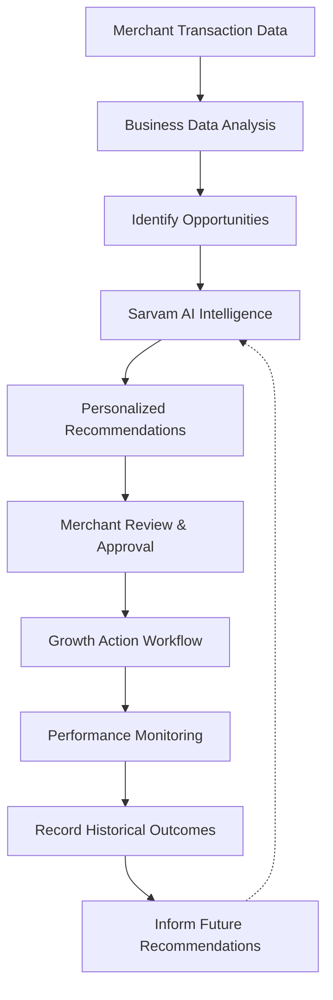

# 🚀 GrowthPilot AI — From Insights to Intelligent Action

<div align="center">

[](#hackathon-track)
[](#hackathon-track)
[](#author)
[](#technology-stack)

</div>

**GrowthPilot AI** is an AI-powered merchant growth platform designed to help businesses understand their sales, identify growth opportunities, and make smarter business decisions.

Built for the **Paytm AI Hackathon — Track 1: Merchant Growth AI**, GrowthPilot AI transforms transaction data into actionable business insights and personalized growth recommendations.

Our goal is to move beyond traditional dashboards by building an intelligent business partner that helps merchants analyze performance, plan growth strategies, execute approved actions, and learn from historical outcomes.

---

## 📌 Table of Contents

- [Problem Statement](#-problem-statement)
- [Our Solution](#-our-solution)
- [Key Features](#-key-features)
- [How It Works](#-how-it-works)
- [Historical Intelligence](#-historical-intelligence)
- [Technology Stack](#️-technology-stack)
- [Project Structure](#-project-structure)
- [Getting Started](#-getting-started)
- [Environment Variables](#-environment-variables)
- [Running the Application](#-running-the-application)
- [API Endpoints & Automated Testing](#-api-endpoints--automated-testing)
- [Demo Data](#-demo-data)
- [Future Enhancements](#-future-enhancements)
- [Hackathon Track](#-hackathon-track)
- [Author](#-author)

---

## 🎯 Problem Statement

Small merchants often face challenges in understanding their business performance and identifying opportunities for growth.

Common challenges include:
- **Difficulty analyzing sales and transaction patterns:** Complex data tables without direct takeaways.
- **Limited access to actionable business intelligence:** Enterprise analytics tools are often unaffordable or overwhelming.
- **Challenges identifying peak and low-sales periods:** Inability to spot off-peak lulls or rush-hour bottlenecks.
- **Lack of personalized, data-driven growth recommendations:** Generic tips instead of tailored business interventions.
- **Difficulty evaluating promotional campaigns:** No simple method to track whether discounts or campaigns actually improved performance.
- **Limited ability to use historical business outcomes to guide future decisions:** Past trial-and-error experiences are lost rather than learned from.

Traditional dashboards show business metrics but often leave merchants to interpret the data and decide what to do next.

> **Merchants need more than analytics. They need an intelligent business growth partner.**

---

## 💡 Our Solution

**GrowthPilot AI** helps merchants turn business data into practical growth strategies.

The platform analyzes transaction history, identifies business patterns, and uses **Sarvam AI** to generate contextual recommendations. Merchants can review suggested actions, approve suitable strategies, and monitor their recorded outcomes.

The long-term vision is to create an intelligent growth system that uses historical business information to make future recommendations more relevant.

### 🌟 Our Vision
> *"Help every merchant make smarter decisions through accessible, AI-powered business intelligence."*

---

## ✨ Key Features

### 1. 📊 Business Health Analysis
Understand business performance through transaction analysis and relevant sales metrics:
- Analyze sales and transaction data in real time.
- Identify business performance trends (daytime vs. evening revenue and order splits).
- Understand changes in sales activity and Average Order Value (AOV).
- Present clear, executive-level business health insights.

### 2. 📈 Hourly Sales Analysis
Analyze sales activity across different hours of the day:
- Compare today's hourly sales directly against historical baselines.
- Identify high-activity peak periods.
- Detect low-sales periods and demand lulls.
- Understand variations in hourly performance.
- Discover opportunities to test targeted promotions.

### 3. 🤖 AI-Powered Growth Recommendations
Use **Sarvam AI** to generate business-specific recommendations based on available transaction insights:
- Identify potential growth opportunities when revenue drops exceed thresholds.
- Generate contextual business suggestions tailored to specific merchant types.
- Explain recommendations using relevant, deterministic business data.
- Help merchants make informed, confident decisions.

### 4. ⚡ Growth Action Activation
Enable merchants to review and approve recommended growth actions:
- Review suggested actions with clear rationale and expected impact.
- **Approve**, customize (discount/title), or **reject** recommendations.
- Track action status (`pending` → `approved` → `active` → `completed`).
- Support campaign execution through implemented workflows.

> [!NOTE]
> *Actual execution depends on available third-party integrations. Simulated actions are clearly identified as demo functionality.*

### 5. 📉 Performance Monitoring
Monitor business metrics and record the outcomes of growth actions:
- Compare relevant business metrics before and after campaign activation.
- Review historical campaign history and recorded uplift percentages.
- Track recorded performance changes.
- Use historical results to inform future decisions.

### 6. 🏪 Multi-Business Support
Support analysis of multiple businesses independently:
- Seamlessly toggle between different merchant profiles (*Sharma Café*, *Gupta Sweets*, *FreshBite Corner*).
- Isolate transaction histories, hourly baselines, and historical campaigns per business.

### 7. 🧠 Historical Business Intelligence — Development Direction
The planned historical intelligence system uses previous transactions, recommendations, and campaign outcomes to provide context-aware recommendations.

The intended workflow is:
1. **Store** relevant business history and transaction data.
2. **Analyze** current business performance deterministically.
3. **Retrieve** relevant previous campaign outcomes and ratings.
4. **Provide** historical context to Sarvam AI.
5. **Generate** a contextual recommendation grounded in past results.
6. **Record** the outcome of the new action.
7. **Use** the recorded history when generating future recommendations.

> [!TIP]
> This approach does not require training a new AI model initially; it leverages prompt context grounding with deterministic financial baselines.  
> *Note: Features described as future enhancements should not be considered fully implemented until integrated and tested.*

---

## 🔄 How It Works

GrowthPilot AI follows a closed-loop, data-driven business growth workflow:



```text
Merchant Transaction Data
        │
        ▼
Business Data Analysis
        │
        ▼
Identify Opportunities
        │
        ▼
    Sarvam AI
        │
        ▼
Personalized Recommendations
        │
        ▼
Merchant Review & Approval
        │
        ▼
Growth Action Workflow
        │
        ▼
Performance Monitoring
        │
        ▼
Record Historical Outcomes
        │
        ▼
Inform Future Recommendations ──── (Closes the Feedback Loop)
```

> The historical feedback loop depends on the availability of stored campaign records and implemented outcome-tracking functionality.

---

## 🧠 Historical Intelligence

GrowthPilot AI is designed to become more context-aware by using previous business data.

For example, suppose a merchant's evening sales have declined compared with the previous week. The system can:
1. **Calculate** the exact percentage change in evening sales deterministically.
2. **Examine** relevant historical transaction patterns across preceding weeks.
3. **Retrieve** previous campaigns addressing similar evening situations.
4. **Review** their recorded outcomes and merchant ratings.
5. **Ask Sarvam AI** to generate an optimized recommendation informed by this history.

This approach combines deterministic business calculations with AI-generated explanations and recommendations.

### 🛡️ Important Design Principles
- **Calculate financial metrics in backend code:** Avoid AI hallucinations by computing mathematical metrics, percentages, and totals using verified formulas.
- **Use historical data only when available and relevant:** Fall back gracefully to smart baseline logic when past history is sparse.
- **Distinguish recorded facts from AI-generated interpretations:** Clearly display observed data separately from AI suggestions.
- **Do not guarantee future campaign performance:** Emphasize that projections are simulated estimates.
- **Clearly label synthetic data and simulated outcomes:** Maintain transparency across all dashboard views.

---

## 🛠️ Technology Stack

| Layer | Technology | Purpose |
| :--- | :--- | :--- |
| **Frontend UI** | **React 18** | Modular component-based dashboard interface |
| **Build Tool** | **Vite 6** | Ultra-fast frontend development server & production bundler |
| **Styling** | **Vanilla CSS** | Custom design system, responsive grids, and micro-animations |
| **Visualization**| **Chart.js** | Interactive sales charts, hourly baselines, and trend lines |
| **Icons** | **Lucide Icons** | Clean, modern iconography |
| **Backend Runtime**| **Node.js** | Scalable JavaScript runtime environment (v18–v26) |
| **Server Framework**| **Express.js** | RESTful API endpoints and business logic controllers |
| **Database** | **MongoDB Atlas** | Persistent storage for merchants, transactions, and campaigns |
| **ORM / ODM** | **Mongoose 9** | MongoDB object modeling with schema validation |
| **AI Engine** | **Sarvam AI** | Large Language Model (`sarvam-105b`) for business growth insights |
| **Package Manager**| **npm** | Dependency management and script orchestration |

### Current Data Storage
- **In-Memory Mode (Zero Setup):** The backend can operate in local-memory mode using `transactions.csv` when `MONGODB_URI` is not configured. Transaction data is loaded into memory, enabling out-of-the-box evaluation without database setup.
- **MongoDB Mode (Persistent):** When `MONGODB_URI` is configured, persistent transaction history, merchant profiles, campaign records, and long-term feedback loops are saved directly to MongoDB Atlas.

---

## 📁 Project Structure

```text
GrowthPilot-AI/
│
├── frontend/
│   ├── public/                      # Static assets
│   ├── src/
│   │   ├── components/              # Modular UI components
│   │   │   ├── Sidebar.jsx          # Navigation sidebar
│   │   │   ├── Topbar.jsx           # Merchant selector & header
│   │   │   ├── WelcomeCard.jsx      # Time-aware merchant greeting
│   │   │   ├── StatsGrid.jsx        # Key KPI cards (Sales, AOV, DoD %, Txns)
│   │   │   ├── BusinessHealth.jsx   # Daytime vs evening sales breakdown
│   │   │   ├── HourlyChart.jsx      # Chart.js sales vs baseline visualization
│   │   │   ├── FlowIndicator.jsx    # 6-stage growth pipeline indicator
│   │   │   ├── GrowthRecommendations.jsx # Opportunity alerts & 3 AI recommendations
│   │   │   ├── PerformanceMonitor.jsx    # Campaign impact & outcome simulation
│   │   │   ├── HistoricalIntelligence.jsx# Deterministic period analysis & trends
│   │   │   ├── CampaignHistory.jsx  # Past campaign logs & merchant feedback
│   │   │   └── AIGrowthAgent.jsx    # Autonomous 8-step agent orchestrator
│   │   ├── pages/
│   │   │   └── Dashboard.jsx        # Master dashboard view
│   │   ├── hooks/
│   │   │   └── useDashboard.js      # Centralized dashboard state hook
│   │   ├── services/
│   │   │   └── api.js               # Centralized REST API client
│   │   ├── utils/
│   │   │   └── formatters.js        # Currency, date, and percentage formatters
│   │   ├── App.jsx                  # Root React application component
│   │   ├── main.jsx                 # Vite application entry point
│   │   └── index.css                # Preserved design system & animations
│   ├── index.html                   # HTML document template
│   ├── package.json                 # Frontend dependencies and build scripts
│   └── vite.config.js               # Vite config with backend API proxy
│
├── backend/
│   ├── models/
│   │   ├── Merchant.js              # Merchant profile Mongoose model
│   │   ├── Transaction.js           # Transaction schema & model
│   │   └── Campaign.js              # Campaign history & outcome model
│   ├── services/
│   │   ├── historicalIntelligence.js# Deterministic financial calculations
│   │   └── campaignFeedback.js      # Campaign feedback loop & rating synthesizer
│   ├── server.js                    # Express REST API server & business logic
│   ├── transactions.csv             # Synthetic merchant transaction dataset
│   ├── transactions_backup.csv      # Benchmark baseline dataset
│   ├── test_endpoints.js            # Automated 16-endpoint test suite
│   ├── .env.example                 # Environment variable template
│   └── package.json                 # Backend dependencies and scripts
│
├── .gitignore                       # Git ignore configuration
├── package.json                     # Root configuration
└── README.md                        # Project documentation
```

> **Note:** This structure is maintained cleanly with no redundant files or circular imports.

---

## 🚀 Getting Started

### Prerequisites
Before running the application, make sure you have:
- **Node.js**: v18.x or later (Node v20+ and v26 fully supported)
- **npm**: v9.x or later
- **Git**: for cloning the repository
- **MongoDB Atlas** or local MongoDB *(optional; automatically runs in resilient in-memory mode if omitted)*
- **Sarvam AI API Key** *(optional; contextual fallback recommendations provided if omitted)*

---

### Step-by-Step Installation

#### 1. Clone the Repository
```bash
git clone https://github.com/AmarjeetKushwaha21/Vyapaar-AI.git
cd Vyapaar-AI
```
*(If your folder is named `GrowthPilot-AI`, navigate to that directory).*

#### 2. Install Backend Dependencies
```bash
cd backend
npm install
```

#### 3. Configure Environment Variables
Create a `.env` file in the `backend/` directory:
```bash
cp .env.example .env
```
Populate the configuration values:
```env
PORT=5001
SARVAM_API_KEY=your_sarvam_api_key
MONGODB_URI=your_mongodb_connection_string
```
> [!WARNING]
> Never commit your real API keys or database credentials to GitHub. Keep `.env` included in `.gitignore`.

#### 4. Start the Backend
From the `backend/` directory:
```bash
npm start
```
The backend server will start on:
```text
http://localhost:5001
```

#### 5. Install Frontend Dependencies
Open a second terminal window and navigate to the `frontend/` directory:
```bash
cd frontend
npm install
```

#### 6. Start the Frontend
From the `frontend/` directory:
```bash
npm run dev
```
Vite will start the local development server:
```text
http://localhost:5173
```
Open [http://localhost:5173](http://localhost:5173) in your browser to explore GrowthPilot AI!

#### 7. Build the Frontend for Production
To generate an optimized production bundle:
```bash
npm run build
```

---

## 🔐 Environment Variables

| Variable | Purpose | Required | Default |
| :--- | :--- | :---: | :--- |
| `PORT` | Listening port for Express backend | Optional | `5001` |
| `SARVAM_API_KEY` | Authenticates requests to Sarvam AI API | Optional* | Smart contextual fallback provided |
| `MONGODB_URI` | MongoDB connection string for persistent storage | Optional* | Transparent in-memory CSV mode |
| `VITE_API_BASE_URL` | Frontend API base URL (in `frontend/.env`) | Optional | `/api` (proxied to backend) |

*\* The application has a resilient architecture: if `MONGODB_URI` or `SARVAM_API_KEY` are not set, it operates seamlessly in local demo mode with fallback logic and synthetic data.*

---

## 🧪 API Endpoints & Automated Testing

GrowthPilot AI includes a comprehensive test suite covering all 16 REST API endpoints.

To run the automated verification:
```bash
cd backend
npm test
```

### Verified Test Output:
```text
[PASS] GET / (Status 200)
[PASS] GET /api/merchants (Status 200)
[PASS] GET /api/status?merchant_name=Sharma Café (Status 200)
[PASS] GET /api/merchant?merchant_name=Sharma Café (Status 200)
[PASS] GET /api/business-health?merchant_name=Sharma Café (Status 200)
[PASS] GET /api/hourly-analysis?merchant_name=Sharma Café (Status 200)
[PASS] GET /api/trigger-check?merchant_name=Sharma Café (Status 200)
[PASS] GET /api/opportunity?merchant_name=Sharma Café (Status 200)
[PASS] GET /api/ai-business-analysis?merchant_name=Sharma Café (Status 200)
[PASS] GET /api/ai-growth-recommendation?merchant_name=Sharma Café (Status 200)
[PASS] POST /api/action (Status 200)
[PASS] GET /api/campaign-result?merchant_name=Sharma Café (Status 200)
[PASS] GET /api/historical-intelligence?merchant_name=Sharma Café (Status 200)
[PASS] GET /api/campaigns?merchant_name=Sharma Café (Status 200)
[PASS] POST /api/agent/cycle (Status 200)
[PASS] POST /api/campaigns/:id/feedback (Status 200)

============================
Endpoint Test Results: 16 Passed, 0 Failed
============================
```

---

## 📊 Demo Data

The project utilizes synthetic transaction records stored in `transactions.csv` (426+ records across 3 merchant categories: Café, Sweets, and Fast Food).

Demo data helps demonstrate:
- Real-time sales calculations and AOV metrics.
- Hourly transaction patterns vs. baseline benchmarks.
- Daytime and evening business splits.
- Sarvam AI recommendation workflows.
- Campaign uplift simulations.

> [!CAUTION]
> **Synthetic Data Notice:** Demo data is generated for illustrative purposes and does not represent real-world merchant financial records. Simulated campaign improvements are calculated projections designed for decision support and demonstration.

---

## 🔮 Future Enhancements

Potential improvements and roadmap directions include:
- **Historical Campaign Intelligence:** Deep reinforcement of past campaign performance over multi-month windows.
- **Context-Aware Recommendations:** Automatic adaptation based on seasonal events, holidays, and weather patterns.
- **AI Growth Agent Autonomy:** Multi-channel merchant-approved action execution (WhatsApp alerts, SMS vouchers, Soundbox prompts).
- **Hindi & Multilingual Voice Assistance:** Natural language voice interactions for non-English speaking merchants.
- **Customer Retention Insights:** Cohort analysis and repeat visit detection from authorized transaction histories.
- **Inventory Intelligence:** Correlation between sales velocity and raw material stock levels.
- **Persistent Campaign Registry:** Full multi-tenant MongoDB Atlas clustering with real-time sync.
- **Direct Ad Integrations:** Direct execution via Paytm merchant marketing channels and local ad networks.
- **Advanced Forecasting:** Time-series forecasting (ARIMA / Prophet) when long-term transaction data is accumulated.

---

## 🏆 Hackathon Track

- **Event:** **Paytm AI Hackathon**
- **Selected Track:** **Track 1 — Merchant Growth AI**
- **Team Name:** **ApexCoders**

### Project Objective
Build an AI-powered business partner that helps merchants understand business performance, identify growth opportunities, manage relevant operations, and make informed decisions.

### Unique Selling Proposition (USP)
GrowthPilot AI moves beyond static analytics dashboards. It bridges the gap between raw transaction data and tangible growth by:
1. Detecting actionable performance dips deterministically.
2. Generating grounded, contextual recommendations via Sarvam AI.
3. Placing the merchant in full control with review, edit, and approval workflows.
4. Closing the loop by tracking outcomes and feeding historical intelligence back into future recommendations.

---

## 👨‍💻 Author

**Amarjeet Kushwaha**  
*B.Tech Computer Science and Engineering*  
ABES Engineering College, Ghaziabad, Uttar Pradesh, India  

- **GitHub:** [@AmarjeetKushwaha21](https://github.com/AmarjeetKushwaha21)
- **LinkedIn:** [Amarjeet Kushwaha](https://www.linkedin.com/in/amarjeet-kushwaha-2627a7397/)

---

<div align="center">

### 🚀 GrowthPilot AI
*From Insights to Intelligent Action.*

**Built with ❤️ by Amarjeet Kushwaha and Team ApexCoders for the Paytm AI Hackathon.**

</div>